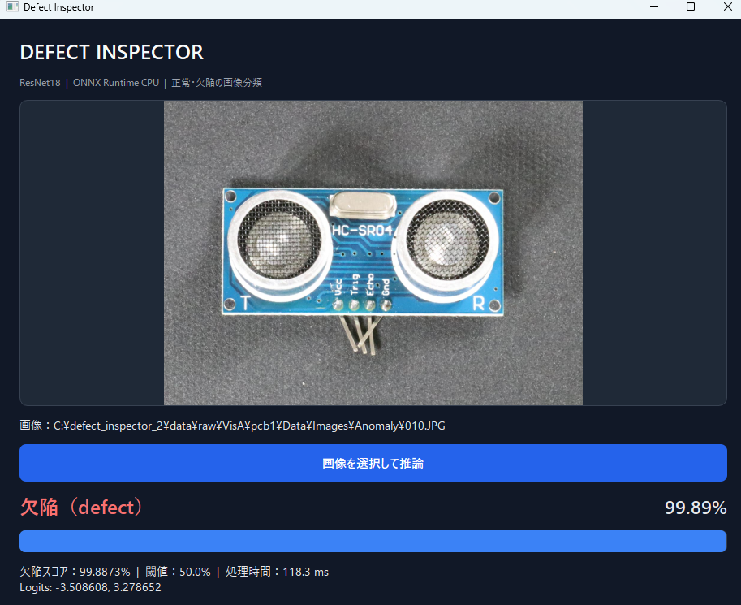

# Defect Inspector 2.0 — VisA PCB1

**PyTorch / ResNet18 → ONNX → Python & C++ inference → PySide6 GUI**

工業製品の画像を入力し、正常（`good`）か欠陥あり（`defect`）かを判定する画像分類プロトタイプ。Amazon Science の **VisA `pcb1`** を使用し、学習・評価・GUIと独立したC++推論を実装しています。

> **対応範囲**：画像単位の2クラス分類。欠陥の位置推定、物体検出、セグメンテーション、実際の製造ラインでの品質保証は行いません。

## デモ



- PySide6 GUI：画像選択、プレビュー、クラス判定、欠陥スコア、logit、推論時間
- Python ONNX Runtime：CPU推論
- C++17 + OpenCV + ONNX Runtime：独立したCPU推論CLI、JSON出力、前処理Tensor出力
- 前処理仕様を `model_metadata.json` で共通管理（RGB、OpenCV線形リサイズ、ImageNet正規化、NCHW float32）

**画像のクレジット：** GUIに表示される画像は Amazon Science の [VisA（Visual Anomaly）データセット](https://github.com/amazon-science/spot-diff) `pcb1` に由来します。VisAデータセットは [CC BY 4.0](https://creativecommons.org/licenses/by/4.0/) で配布されています。スクリーンショットはGUI上で表示サイズを変更した画像を含みます。データセット画像の権利は原著作者に帰属します。

## 技術構成

| 領域 | 技術 |
|---|---|
| 学習 | Python 3.12 / PyTorch / torchvision |
| モデル | ImageNet事前学習ResNet18、出力2クラス、全層Fine-tuning |
| 評価 | scikit-learn / NumPy |
| 前処理 | OpenCV / Pillow、384×512（高さ×幅） |
| モデル交換 | ONNX Opset 18 |
| Python推論・GUI | ONNX Runtime CPU / PySide6 |
| C++推論 | C++17 / ONNX Runtime CPU / OpenCV / nlohmann-json |
| ビルド | CMake / Visual Studio / vcpkg |

## データセット・分割

Amazon Scienceの公開データセット **VisA `pcb1`** と、公式 `2cls_highshot.csv` のTrain/Test割り当てを使用。
公式Trainだけを**seed=42**で層化分割してValidationを作成し、公式Testは変更していません。

| Split | good | defect | 合計 |
|---|---:|---:|---:|
| Train | 481 | 48 | 529 |
| Validation | 121 | 12 | 133 |
| 公式Test | 402 | 40 | 442 |
| **合計** | **1,004** | **100** | **1,104** |

分割定義：`data/splits/visa_pcb1_highshot_v1.json`。画像の完全重複は検査していますが、**同一製品・撮影系列など、関連画像グループの独立性は未確認**です。見た目が非常に似たPCB画像が多数あり、性能の解釈にはこの制約が残ります。

データセット本体はGitHubリポジトリに含めません。

- [公式VisAデータセット](https://github.com/amazon-science/spot-diff)
- [公式アーカイブ `VisA_20220922.tar`](https://amazon-visual-anomaly.s3.us-west-2.amazonaws.com/VisA_20220922.tar)
- [公式 `2cls_highshot.csv`](https://github.com/amazon-science/spot-diff/blob/main/split_csv/2cls_highshot.csv)

データとCSVを取得したら、ローカルで次の配置にします。

```text
data/
  official/2cls_highshot.csv
  raw/VisA/pcb1/Data/
    Images/Normal/*.JPG
    Images/Anomaly/*.JPG
    Masks/Anomaly/*.png
  splits/visa_pcb1_highshot_v1.json
```

アーカイブには複数カテゴリが含まれますが、本プロジェクトが使うのは `pcb1` だけです。

## 学習設定

| 項目 | 値 |
|---|---|
| モデル | ResNet18（ImageNet `IMAGENET1K_V1`で初期化） |
| 入力 | 高さ384×幅512 / RGB / float32 NCHW |
| 正規化 | ImageNet mean=(0.485,0.456,0.406), std=(0.229,0.224,0.225) |
| Epoch | 12 |
| Batch size | 8 |
| Optimizer | AdamW（lr=1e-4、weight decay=0.01） |
| Loss | 重みなしCrossEntropyLoss |
| 乱数seed | 42 |
| 判定閾値 | 0.5（固定） |
| モデル選択 | Validation Average Precision 最大、同点の場合は先のEpoch |
| 最良Epoch | **2** |
| 最良Validation AP | **0.9142** |

学習ではRTX 5060を使用。Validationの欠陥画像は12枚と少なく、指標にばらつきが見られました。

## 公式Test評価

**公式Test 442枚（正常402、欠陥40）** を、最良Epoch 2と固定閾値0.5で1回評価した結果。

| 指標 | 結果 |
|---|---:|
| Accuracy | **0.9638** |
| Average Precision (AP) | **0.9593** |
| ROC AUC | **0.9955** |
| Precision（欠陥） | **0.7222** |
| Recall（欠陥） | **0.9750** |
| F1（欠陥） | **0.8298** |

| 実際 \ 予測 | good | defect |
|---|---:|---:|
| good | **TN 387** | **FP 15** |
| defect | **FN 1** | **TP 39** |

欠陥40枚中39枚を検出しました。一方で正常402枚中15枚を欠陥と誤判定しています。Accuracyだけではクラス不均衡の影響を見落とすため、Recall、Precision、FP/FNを併記します。

公式Testの結果を使って閾値や学習条件を後から調整していません。**この結果はVisAの当該分割における評価値であり、実環境への汎化や製造ラインでの性能を保証しません。**

### 評価の根拠となる実験記録

[実験記録フォルダー](reports/resnet18_visa_pcb1_20261107_224730_164330/)に、以下を保存しています。

- `experiment_config.json`：学習条件、使用した分割ファイルのSHA-256
- `history.json`：全12 Epochの学習・Validation指標
- `model_metadata.json`：前処理仕様、選択Epoch、ONNXのSHA-256
- `best_validation_predictions.json`：選択モデルのValidation 133件の予測
- `onnx_export_report.json`：正常・欠陥各1枚のPyTorch／ONNX比較記録
- `test_predictions.csv`：公式Test 442件の正解ラベル、予測、欠陥スコア
- `test_evaluation.json`：公式Testの集計指標

保存された予測からTestの全掲載指標を再計算し、評価JSONとの一致を確認しています。
また、学習履歴ではEpoch 2のValidation APが全12 Epoch中で最大です。
これらは保存記録の整合性確認であり、第三者環境でのモデル再実行やC++推論の再検証を意味しません。

## Python / C++ 推論の整合性

- PyTorch とPython ONNX Runtime：Validationの正常・欠陥各1枚でlogitと判定が一致（ONNXエクスポート時の許容誤差チェック）。
- Python とC++ ONNX Runtime：正常・欠陥各1枚について、前処理Tensorと同一入力に対するlogitが一致（提示ログの最大絶対誤差はいずれも0.00000000）。
- Python GUI推論エンジン：同じ2枚の判定が期待値と一致。

**整合性検証は2枚について確認したもの**で、データセット全件の一致検証ではありません。

## 環境構築・再現手順（Windows PowerShell）

> 以下は開発環境で使った手順です。第三者のクリーンなWindows環境での通し実行は未検証です。学習にはCUDA対応PyTorchとNVIDIA GPUが必要です。

### 1. Python環境

```powershell
py -3.12 -m venv .venv
.\.venv\Scripts\python.exe -m pip install -e ".[dev]"
# GPU学習時は環境に合ったCUDA対応PyTorchを別途インストール
```

### 2. VisAデータの配置・監査・分割

VisAアーカイブと公式CSVをダウンロードし、上記のフォルダー構成で `pcb1` 画像・異常マスクを配置する。

```powershell
.\.venv\Scripts\python.exe .\tools\audit_visa_pcb1.py
# 分割は同梱済みの data/splits/visa_pcb1_highshot_v1.json を使用します。
.\.venv\Scripts\python.exe -m pytest tests/test_visa_data.py -v
```

### 3. モデル学習

```powershell
.\.venv\Scripts\python.exe -m defect_inspector.train_visa `
  --epochs 12 --batch-size 8 --lr 0.0001 --height 384 --width 512
```

実行ごとに別の `artifacts/experiments/resnet18_visa_pcb1_.../` が作られます。結果はGPU・依存ライブラリ等によって変動する可能性があります。

### 4. ONNXに変換

```powershell
$run = ".\artifacts\experiments\<学習で生成されたVisAフォルダー名>"
.\.venv\Scripts\python.exe -m defect_inspector.export_onnx --run-dir "$run"
```

### 5. GUI起動と公式Test評価

```powershell
.\.venv\Scripts\python.exe -m defect_inspector.gui --run "$run"
.\.venv\Scripts\python.exe .\tools\evaluate_visa_test.py --run-dir "$run"
```

`evaluate_visa_test.py` は `test_evaluation.json` または `test_predictions.csv` が存在する場合、**上書きを拒否**します。評価は最終条件を固定した後に1回実施してください。

### 6. C++ CLI（Windows）

開発環境にはVisual Studio C++ツールチェーン、CMake、vcpkg、ONNX Runtime C++ SDKが必要です。
ONNX Runtime SDK `onnxruntime-win-x64-1.31.1` を `external/` に配置し、`cpp/CMakeLists.txt` が参照できるようにします。

```powershell
# 初回構成例：vcpkgの導入先とVisual Studioジェネレーター名は環境に合わせて変更
cmake -S .\cpp -B .\cpp\build -A x64 `
  "-DCMAKE_TOOLCHAIN_FILE=$HOME/vcpkg/scripts/buildsystems/vcpkg.cmake"
cmake --build .\cpp\build --config Release --parallel 4

.\cpp\build\Release\defect_inspector_cpp.exe `
  --model "$run\model.onnx" `
  --metadata "$run\model_metadata.json" `
  --image ".\data\raw\VisA\pcb1\Data\Images\Anomaly\010.JPG"
```

C++ OpenCVをvcpkg経由で導入する際は、`cpp/vcpkg.json` で `opencv4` の `jpeg` 機能を有効にする必要があります（PNGのみでは `.JPG` を読めません）。

## リポジトリ構成（主要ファイル）

```text
src/defect_inspector/
  model.py               # ResNet18
  preprocessing.py       # 共通前処理
  visa_data.py           # VisA Dataset
  training.py            # 共通学習・検証関数
  train_visa.py          # VisA学習
  export_onnx.py         # ONNX変換・数値比較
  gui.py                 # PySide6 GUI / Python ORT
cpp/
  vcpkg.json
  CMakeLists.txt
  src/main.cpp           # C++17 ORT推論CLI
tools/
  audit_visa_pcb1.py
  prepare_visa_splits.py
  check_visa_split_similarity.py
  evaluate_visa_test.py
docs/images/
  visa-defect-demo.png
```

## 制約と今後の改善

- 画像単位の分類のみで、欠陥位置は提示しない。
- 公式Testで欠陥1件を見逃し、正常15件を誤検出した。
- 類似PCB画像の**関連グループ独立性は未確認**。データ分割による評価の楽観化を排除できない。
- Python/C++数値比較は代表2枚のみ。
- 実環境での撮影条件変化への耐性、性能測定、本番品質は未検証。
- 学習済みONNXモデルの公開・再配布条件をまだ確認しきれていないため、本リポジトリにモデル本体は含めない想定。動作させるには、公式データでのローカル学習または権利条件を確認したモデル入手手段が必要。

## データの出典・ライセンス

- **VisA (Visual Anomaly)**: Yang Zou, Jongheon Jeong, Latha Pemula, Dongqing Zhang, Onkar Dabeer. *SPot-the-Difference Self-Supervised Pre-training for Anomaly Detection and Segmentation*, ECCV 2022 / [arXiv:2207.14315](https://arxiv.org/abs/2207.14315).
- [データセット公式リポジトリ](https://github.com/amazon-science/spot-diff)、[AWS Open Data Registry](https://registry.opendata.aws/visa/)、[CC BY 4.0](https://creativecommons.org/licenses/by/4.0/)。
- VisA画像・公式配布物を含める場合は、出典・ライセンス表示とその他の条件を守る必要があります。モデル本体と本リポジトリのソースコードに対するライセンスは、データセットのライセンスとは別途判断します。

*研究・学習用プロトタイプ。品質保証設備としての利用は想定していません。*
